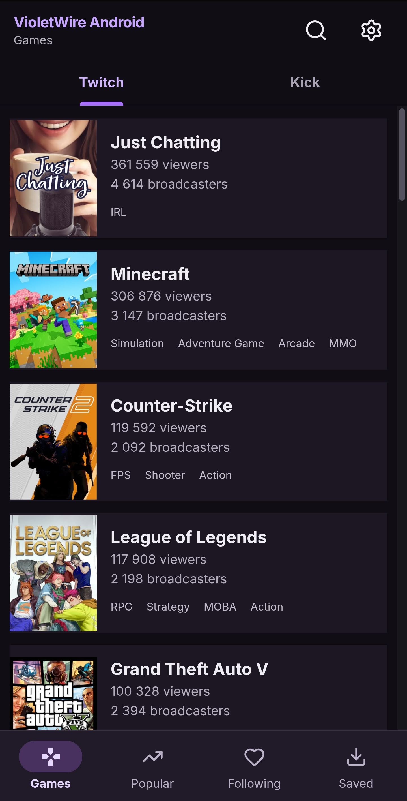
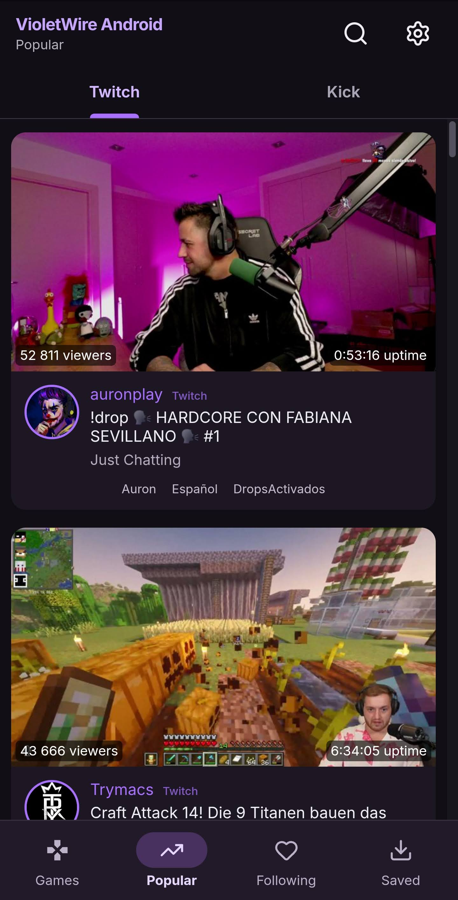
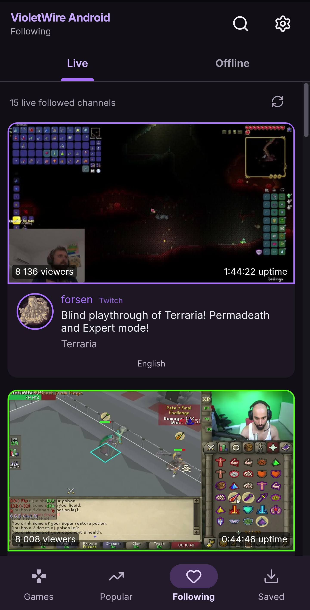
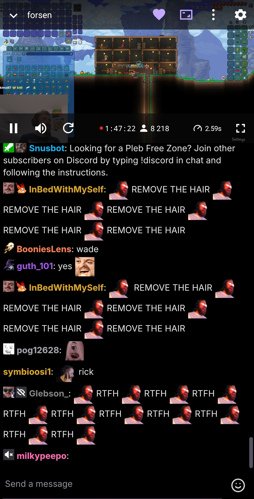
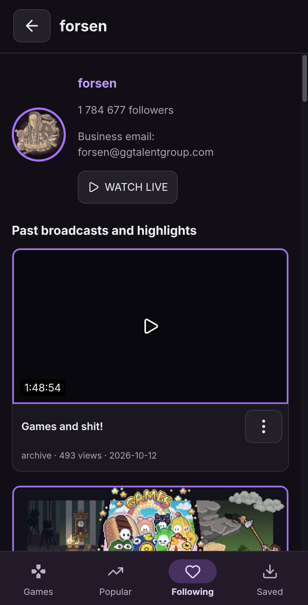
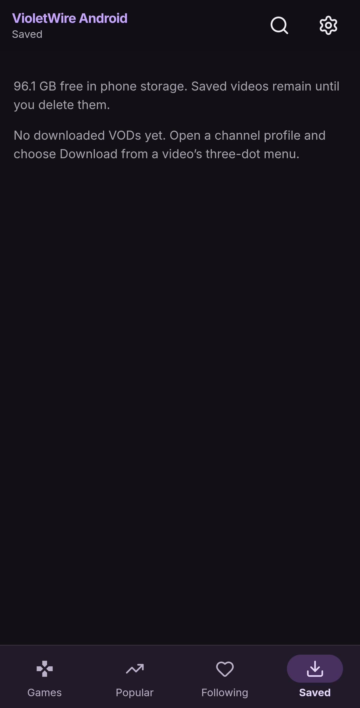
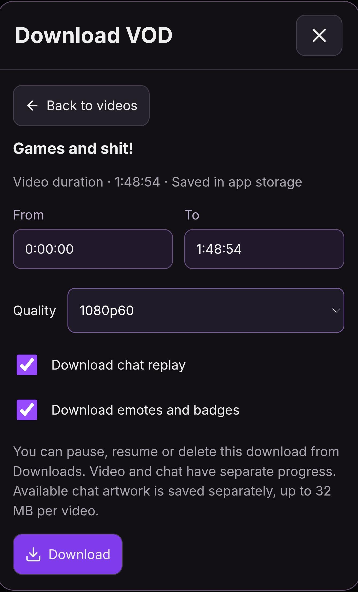

  

<h1 align="center">VioletWire Android</h1>

  
  

  
  
  
  

  
  
  

## Features

- Supports Twitch and Kick streams.
- Supports popular emotes from 7TV, FrankerFaceZ and BetterTTV.
- Downloads and caches emotes to display them faster.
- Watch VODs with chat replay.
- Download VODs to watch offline on the go, with chat replay.
- Picture-in-picture mode.
- Streams keep playing when you lock your phone.
- Low-latency playback of around 2.6 seconds to keep streams and chat in sync.
- Uses proxies only during ads, then switches back to direct playback.
- Data saver mode to help reduce usage of your monthly data allowance.

## Download & installation

1. If you do not already have an app for opening <code>.APK</code> files, try [Files by Google](https://play.google.com/store/apps/details?id=com.google.android.apps.nbu.files), made by Google LLC.
2. Download the VioletWire Android <code>.APK</code> from the [latest GitHub release](https://github.com/Garries420/VioletWire-Android/releases/latest).

   

3. Open the downloaded <code>.APK</code> in your file manager and tap **Install**. If Android asks, allow that app to install apps from this source.

> [!IMPORTANT]
> **Updating an existing installation:** Follow the same steps and tap **Update** when prompted. A compatible update keeps your Twitch and Kick sign-ins and your settings.

> [!WARNING]
> **Check for `READ ME BEFORE INSTALL.txt` in the release assets.** If it is present, read it before installing. It explains why that particular release requires uninstalling the old app, which versions are affected, and what to do next. Uninstalling removes your local settings and sign-ins, so you will need to set up the app and sign in again.

## Third-party software & credits

VioletWire Android brings together [React](https://github.com/facebook/react) and [Capacitor](https://github.com/ionic-team/capacitor) for its interface and Android integration. [AndroidX Media3 / ExoPlayer](https://github.com/androidx/media) handles native video playback, background playback and VOD downloads. Emotes come from [7TV](https://7tv.app/), [FrankerFaceZ](https://www.frankerfacez.com/) and [BetterTTV](https://betterttv.com/), alongside Twitch's own emotes.

The app's stream resolvers connect directly to Twitch and Kick. During Twitch ads, the temporary fallback can use the independently operated [Luminous](https://github.com/AlyoshaVasilieva/luminous-ttv) and [Perfprod](https://wiki.cdn-perfprod.com/) proxy services. [Xtra](https://github.com/crackededed/Xtra) provided Android UI and public protocol references; VioletWire Android's implementations were developed independently.

Additional shared UI components use [hls.js](https://github.com/video-dev/hls.js), [Lucide](https://lucide.dev/), [Inter](https://rsms.me/inter/) and [flag-icons](https://github.com/lipis/flag-icons). Their licences and attribution are listed in [third-party notices](THIRD_PARTY_NOTICES.md).

**Original VioletWire:** Created by [Lucaboox](https://github.com/lucaboox). Visit the [original VioletWire project](https://github.com/lucaboox/VioletWire).

**Android fork:** [Garries420](https://github.com/Garries420). Development assistance from [OpenAI Codex](https://github.com/openai/codex).

VioletWire Android continues under [GPL-3.0-or-later](LICENSE). [Build instructions](docs/BUILDING.md).
